# Trials of Mana — русский перевод (SNES)

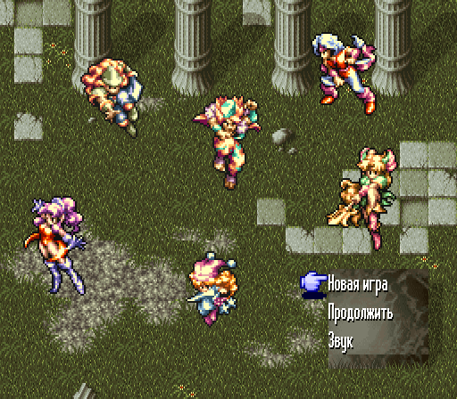 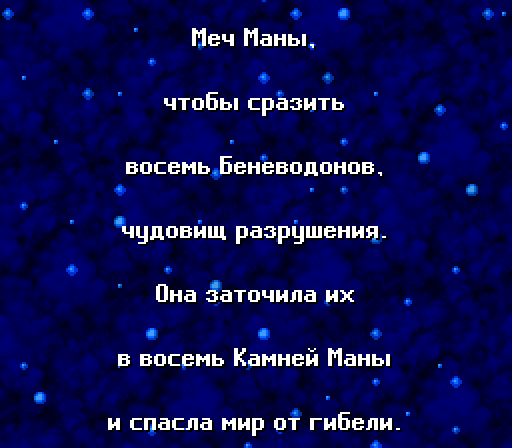
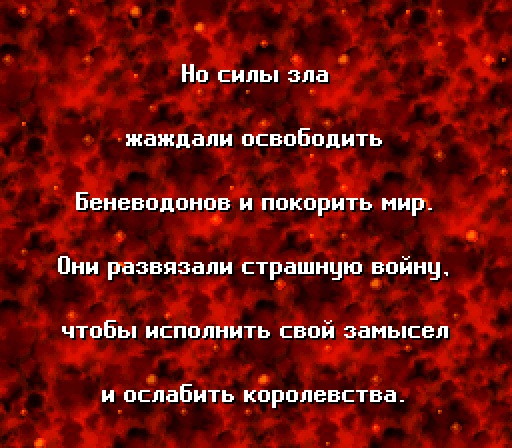 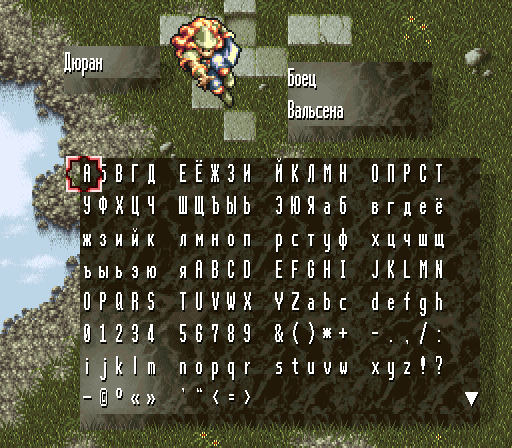
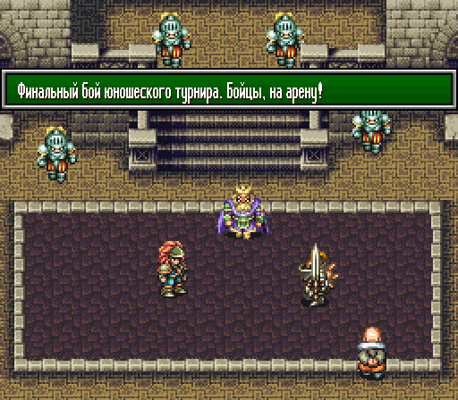
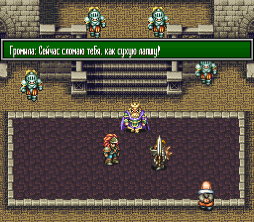 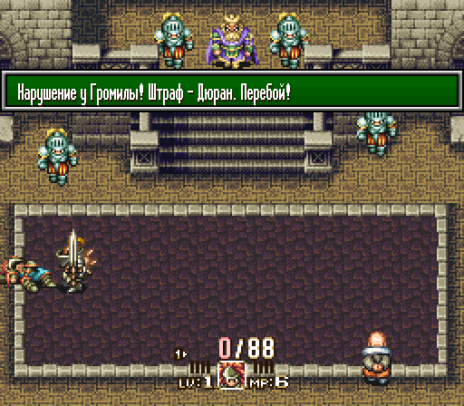
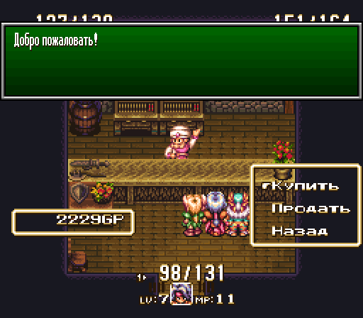 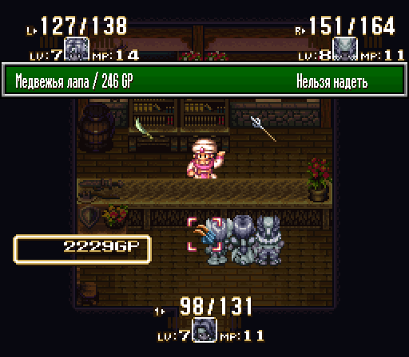
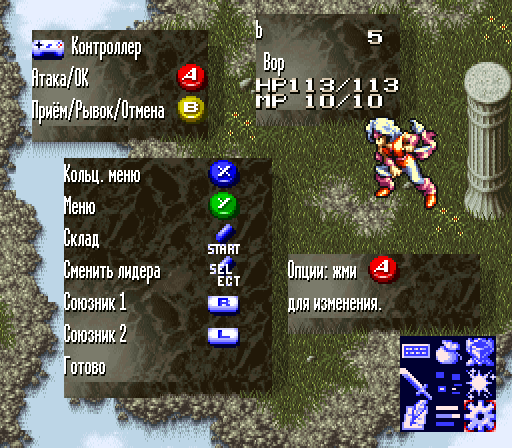

Концовка:

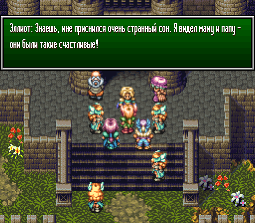 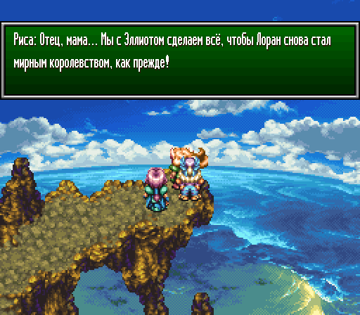
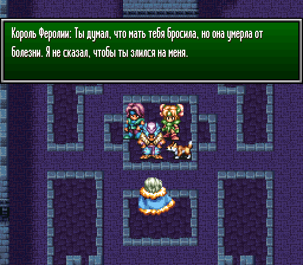 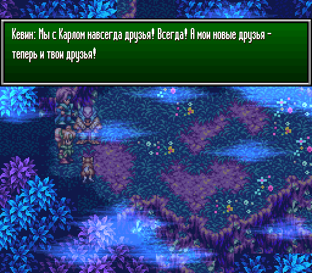
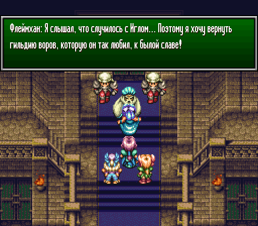 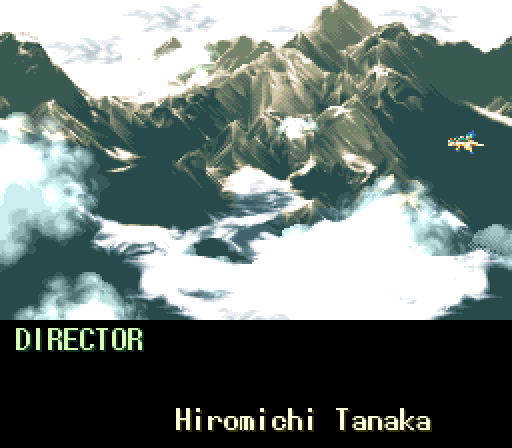

ЧТО ЭТО
-------
Перевод Seiken Densetsu 3 / Trials of Mana (SNES, 1995) на русский язык.
Патч накладывается на официальный английский ROM из Collection of Mana.

Статус: **beta**. В тексте возможны опечатки и неудачные формулировки. Сообщения об ошибках принимаются в
[Issues](https://github.com/eightbithero/rus-mana-3/issues), лучше со
скриншотом.

ЧТО ПЕРЕВЕДЕНО
--------------
  * Все диалоги и сюжетные сцены.
  * Меню, предметы, снаряжение, магия, приёмы, классы, названия монстров.
  * Вступительная заставка (текст перерисован кириллицей).
  * Подписи над врагами в бою (шрифт 8×8 дополнен кириллицей, включая Ё).
  * Экран ввода имени: русский и латинский алфавиты, цифры и знаки.

Имена героев и мест — по официальному английскому изданию 2019 года
(Дюран, Анжела, Хокай, Риса, Шарлотта, Кевин, Вальсена, Неварл, Лоран).
Говорящие названия монстров, предметов и заклинаний переведены по смыслу
с оглядкой на японский оригинал.

ПРИМЕНЕНИЕ
----------
Скачайте *.ips из последнего [релиза](https://github.com/eightbithero/rus-mana-3/releases)
и наложите его на ROM из собственной легально купленной копии Collection of
Mana (без копир-заголовка):
```
  Trials of Mana (World) (Collection of Mana).sfc
  размер   6 291 456 байт
  CRC32    9743DC0E
  MD5      c9829d76e25f8c4bf459cf77a8306825
  SHA-1    462580125693a73da90da08d415023a885d84d1d
```

Подойдёт любой IPS-патчер: Flips, Lunar IPS или онлайн-патчер
https://www.marcrobledo.com/RomPatcher.js/

IPS не проверяет исходный файл. Если результат не совпадает с указанными
суммами, проверьте CRC32 исходного ROM.

Японский ROM Seiken Densetsu 3 и английский фан-перевод 2000 года
(SD3EN101) не подходят.

ТЕКСТ ПЕРЕВОДА
--------------
[translation.csv](translation.csv) — весь текст игры в одной таблице
(UTF-8, разделитель — запятая):

| Столбец | Содержимое |
|---|---|
| `id` | ключ строки: `dXXXXXX_N` — диалоги, `sXXXX` — системный текст |
| `jp` | японский оригинал (для системного текста — только имена и названия) |
| `en` | английский оригинал (Collection of Mana) |
| `ru` | русский перевод в том виде, в каком он записан в ROM |

Управляющие коды игры оставлены как есть: `<17>` — перенос строки, `<12>` —
новая страница, `<18:NN>` — пауза, `<19:NN>` — имя героя. Несколько
десятков отладочных строк, которые игрок не видит, не переведены.

ТЕХНИЧЕСКИЕ ЗАМЕТКИ
-------------------
  * Размер и раскладка ROM не изменились (48 Мбит, ExHiROM).
  * Основной шрифт с переменной шириной символов дополнен кириллицей,
    текст упакован штатным для игры сжатием.
  * Окно выбора в магазине расширено под русские слова.
  * Таблица символов экрана ввода имени генерируется из переведённой
    раскладки.
  * Проверено в Mesen 2 на сохранениях по всей игре, снятых с
    TAS-прохождения.

ИЗВЕСТНЫЕ ОГРАНИЧЕНИЯ
---------------------
  * Имя героя подставляется в текст всегда в именительном падеже, поэтому
    некоторые фразы построены так, чтобы имя не склонялось.

НА РЕАЛЬНОМ ЖЕЛЕЗЕ
------------------
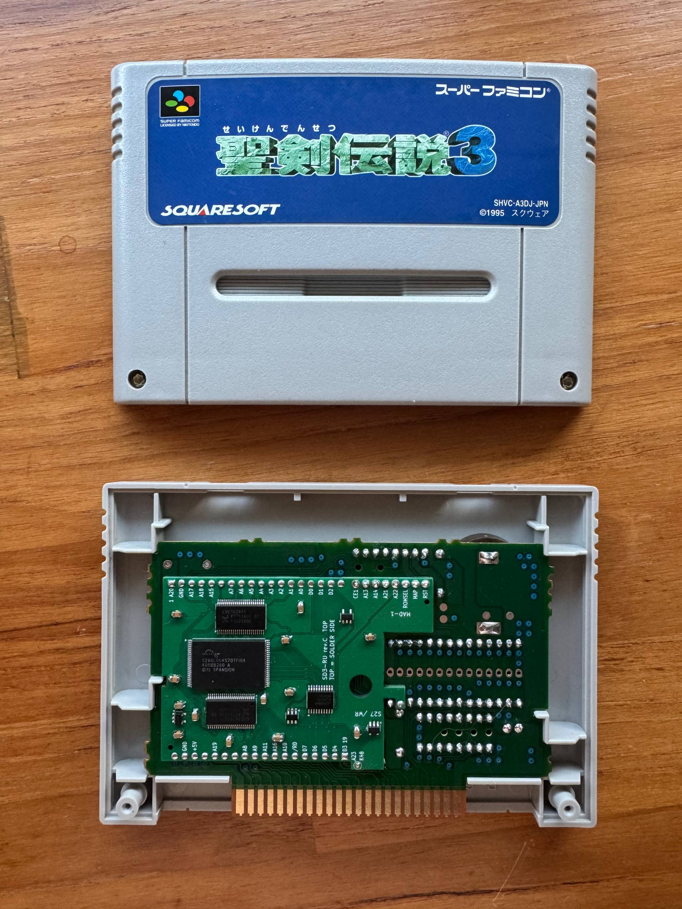

Патч проверяется на настоящей консоли. Плата SD3-RU с флеш-памятью
устанавливается вместо ROM-чипов в оригинальный японский картридж
Seiken Densetsu 3 (SHVC-A3DJ-JPN). Плата совместима с Sanni Dumper.

Статус: идёт плейтест. Файлы проекта платы будут опубликованы после его
завершения.

---

## English

Russian translation of Trials of Mana (Seiken Densetsu 3) for the SNES.
Status: **beta**.

Apply the *.ips from the latest [release](https://github.com/eightbithero/rus-mana-3/releases)
to the English ROM from your own legally purchased copy of Collection of
Mana, unheadered:
```
  Trials of Mana (World) (Collection of Mana).sfc
  размер   6 291 456 байт
  CRC32    9743DC0E
  MD5      c9829d76e25f8c4bf459cf77a8306825
  SHA-1    462580125693a73da90da08d415023a885d84d1d
```

[translation.csv](translation.csv) holds the full script: `id`, Japanese
original, English original and the Russian text as built into the ROM.

A ROM-replacement board (SD3-RU) for an original Japanese Seiken Densetsu 3
cartridge is in playtesting; it is compatible with Sanni Dumper. Project
files will be published afterwards.
